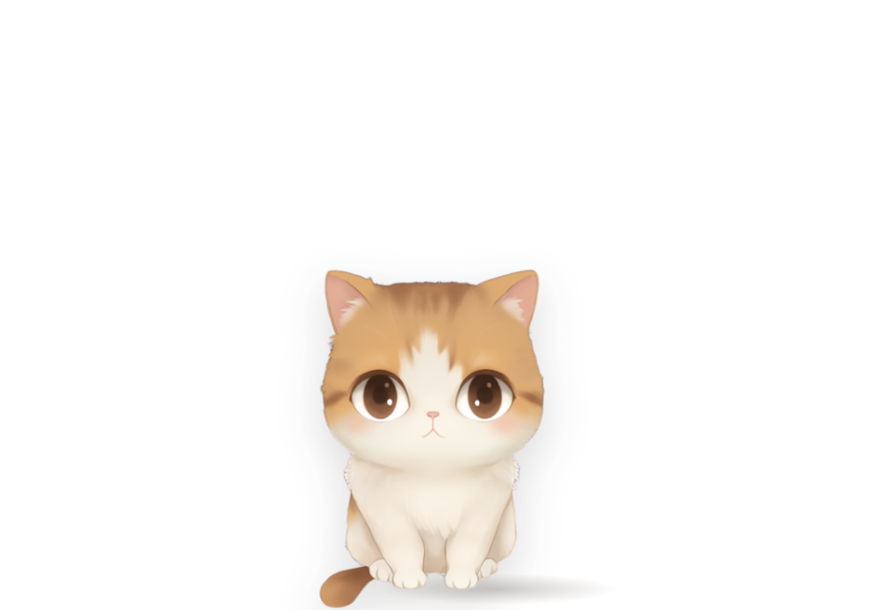
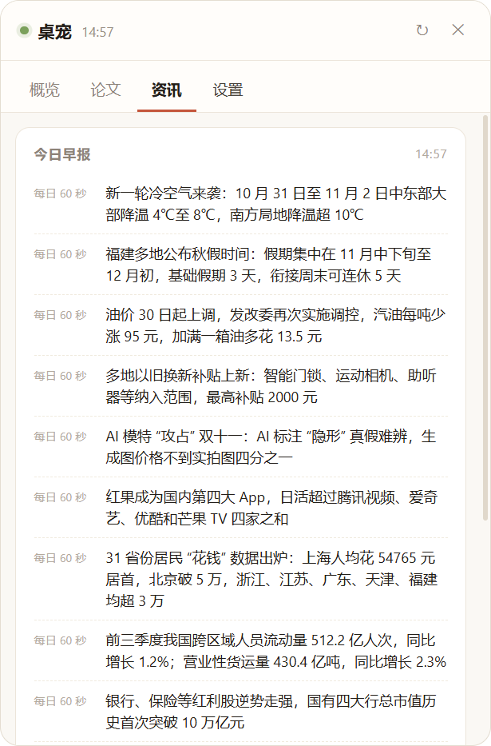
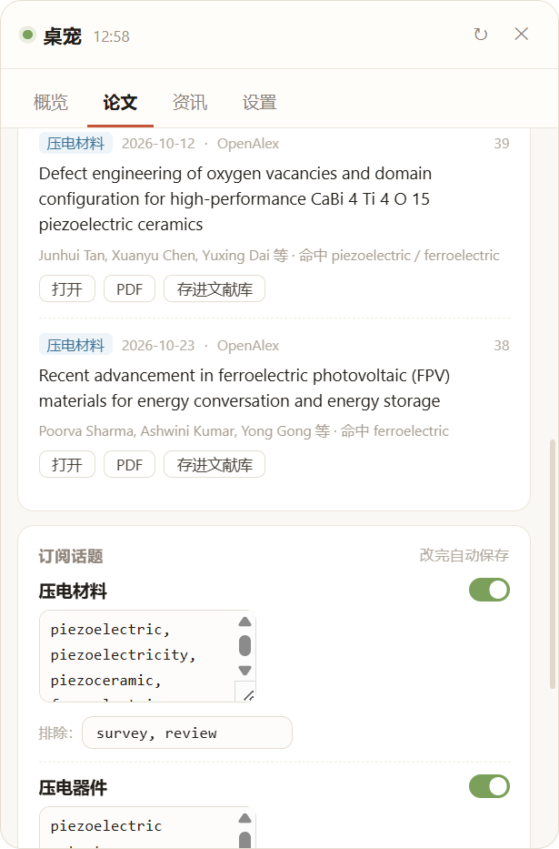
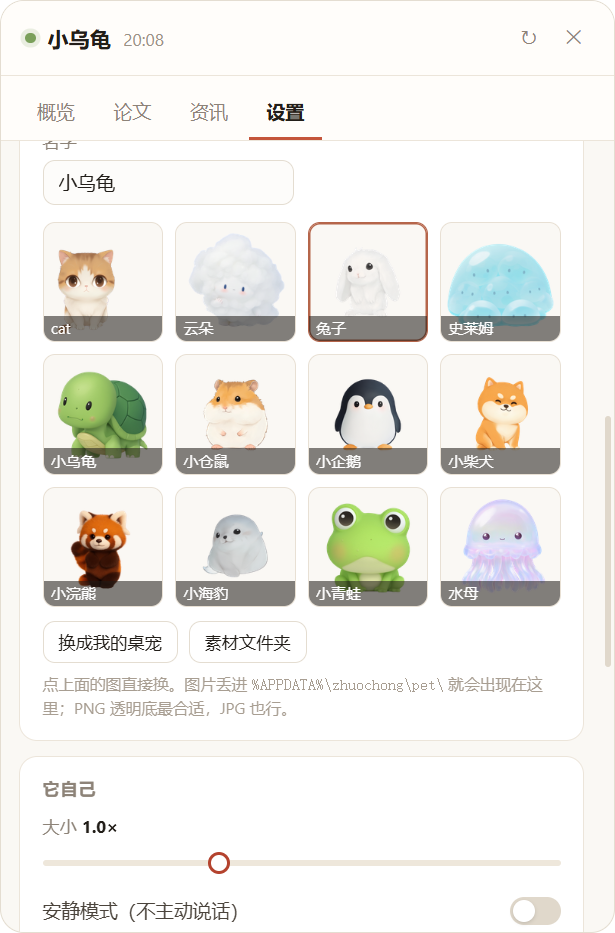

# 桌宠 · Zhuochong

一只**真的有用**的桌面宠物。不是会动的壁纸——它盯着你的天气、API 余额、显卡状态、今天有什么新论文，然后在该说话的时候主动说一句。

Windows / Electron / 无后端 / 数据全在本机。



## 它和别的桌宠不一样的地方

绝大多数桌宠是「点了才理你」。这个反过来：**它自己会说话**。

- 每 5 分钟（可调）主动播报一条：天气 / API 余额 / 资讯 / 论文，四类轮着来
- 抓到新资讯或新论文会提前插播
- **左键点它** → 换下一条；**右键点它** → 打开卡片坞看详情
- 不想被吵：设置里关掉「自己播报」，或把间隔拉到 15 分钟

## 功能

| | |
|---|---|
| **天气** | 实时温度、体感、逐小时；未来 2 小时要下雨会提前提醒（Open-Meteo，免费无 Key） |
| **API 余额** | DeepSeek / Moonshot / 硅基流动 / OpenRouter 聚合；今日消耗、优惠时段、余额曲线、见底告警 |
| **系统** | CPU / 内存 / 磁盘 / GPU / 网速。N 卡走 `nvidia-smi`，其他走 Windows GPU 引擎计数器 |
| **论文雷达** | 订阅话题（关键词 + 排除词 + 分类）→ 抓 arXiv → 打分排序 → 每天给你 6 篇。可存进文献库、一键导 BibTeX |
| **早报** | 量子位 / 爱范儿 / Solidot / 少数派 / 每日 60 秒，去重后取 16 条 |
| **框选识别** | `Ctrl+Shift+A` 框一块屏幕 → 本地 OCR → 文字进剪贴板；配了 Key 还会修正错字并附一句中文解释 |
| **桌宠本体** | 呼吸、走路、发呆、睡觉、拖拽抛掷、落地压扁；支持任意图片素材，可自定义名字 |





## 快速开始

需要 Node.js 18+。

```bash
git clone https://github.com/Lian-wen/zhuochong.git
cd zhuochong
npm install
npm start
```

Windows 用户也可以直接双击 **`启动桌宠.bat`**（会自动装依赖）。

启动后建议做两件事：

1. **填 API Key**（可选，但余额卡和论文摘要需要）——右键点桌宠 → 设置 → API Key
2. **选城市** —— 设置 → 位置，输入城市名搜索

## 快捷键

| 键 | 作用 |
|---|---|
| 左键点桌宠 | 换一条播报（天气 → 余额 → 资讯 → 论文 循环） |
| 右键点桌宠 | 打开卡片坞 |
| `Ctrl + Shift + A` | 框选截图 → OCR → 进剪贴板 |
| `Ctrl + Shift + H` | 老板键，瞬间藏起来 |
| `Ctrl + Shift + S` | 全屏截图到剪贴板 |
| 拖住甩出去 | 有重力、会弹、会摔 |

## 换成你自己的桌宠

设置 → **我的桌宠**，点缩略图直接换，名字随便改。

素材放这两个地方之一，界面里都会列出来：

- `%APPDATA%\zhuochong\pet\` —— 点「换成我的桌宠」选的图会复制到这里
- `assets\pet\` —— 内置素材

要求：PNG 透明底最好，正面或 3/4 侧面，400~1200px 高足够（1600px 以上只是白占内存，面板缩略图会自动压到 140px）。

**单张图能做到的动画**：呼吸（底部纵向起伏）、走路颠簸 + 侧倾、落地压扁回弹、拖拽拉伸、睡觉变暗。再往上（摆尾巴、转头、眨眼）需要拆层或 Live2D 绑骨，单图做不到。

## 数据都去哪了

- 配置和密钥：`%APPDATA%\zhuochong\config.json`，API Key 用 **Windows DPAPI** 加密，换台电脑解不开
- 余额历史 / 文献库：同目录下 `history.json`、`library.json`
- 截图：`图片\桌宠截图\`
- **没有任何服务端**，所有请求都是你本机直连第三方 API

## 已知问题

**启动白屏 / 闪退** —— 部分环境（远程桌面、虚拟机、受限账户）里 Electron 的 GPU 进程起不来。程序会自我修复：GPU 崩 2 次或页面 10 秒没加载完，会自动带 `--soft --no-sandbox` 重启。还不行就双击 `兼容模式启动.bat`，那个窗口不关，会显示报错。

**arXiv 抓不到** —— 官方 API 在部分网络下会 429 / 503。程序会自动降级到 OpenAlex（免费、免 Key、还带引用数），卡片右上角会标出用的哪个源。

**`.bat` 里的中文** —— 批处理文件必须存成 GBK，cmd 按系统 ANSI 代码页逐字节读，存 UTF-8 会解析错位。仓库里两个 `.bat` 都是 GBK。

## 项目结构

```
main.js              主进程：窗口、托盘、热键、调度、提醒
preload.js           IPC 白名单
lib/store.js         配置 + DPAPI 密钥保险箱
lib/providers.js     数据源：天气 / 余额 / 资讯 / 论文 / 系统 / GPU / BibTeX
renderer/stage.*     宠物舞台（屏幕底部一条透明窗口）
renderer/panel.*     卡片坞
renderer/selector.*  框选遮罩
assets/pet/          内置素材
tools/               图标生成、OCR 脚本、CDP 自检脚本
```

`tools/probe.js` 是个小工具：`electron . --probe --remote-debugging-port=9222` 后用 CDP 查 DOM、抓截图，在没有可视桌面的环境里也能验证界面。

## 打包成 exe

```bash
npm run dist
```

产物在 `release/`：

- `Zhuochong-Setup-0.2.0.exe` —— 安装版，可选安装目录、自动建桌面快捷方式
- `Zhuochong-0.2.0-portable.exe` —— 免安装绿色版，双击即用，拷到 U 盘也能跑

国内网络如果卡在下载打包工具（winCodeSign / nsis），改用镜像：

```bash
set ELECTRON_BUILDER_BINARIES_MIRROR=https://npmmirror.com/mirrors/electron-builder-binaries/
npm run dist
```

打包时 `assets/pet/` 里除 `cat.png` 外的图会被排除（`build.files` 里写了 `!assets/pet/!(cat.png)`），因为那些是个人素材，不该进安装包。

## 设计取舍

用 Electron 是因为它能在 Windows 上稳定做「透明 + 置顶 + 点击穿透」的窗口，代价是安装包大、常驻内存约 120MB。如果哪天要瘦身，`renderer/` 那三份文件可以一行不改地搬去 Tauri，只有 `main.js` 要重写成 Rust。

## License

MIT

---

**English**: Zhuochong is a Windows desktop pet that proactively reports weather, API balance, GPU/system status, arXiv papers and daily news — instead of waiting for you to click it. Left-click cycles through topics, right-click opens the dashboard, `Ctrl+Shift+A` does region capture + local OCR. Built with Electron, no backend, API keys encrypted locally with Windows DPAPI.
